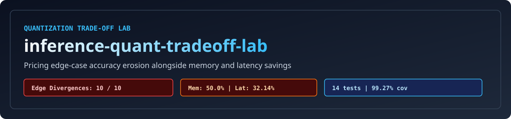
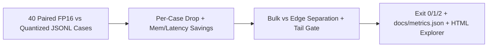
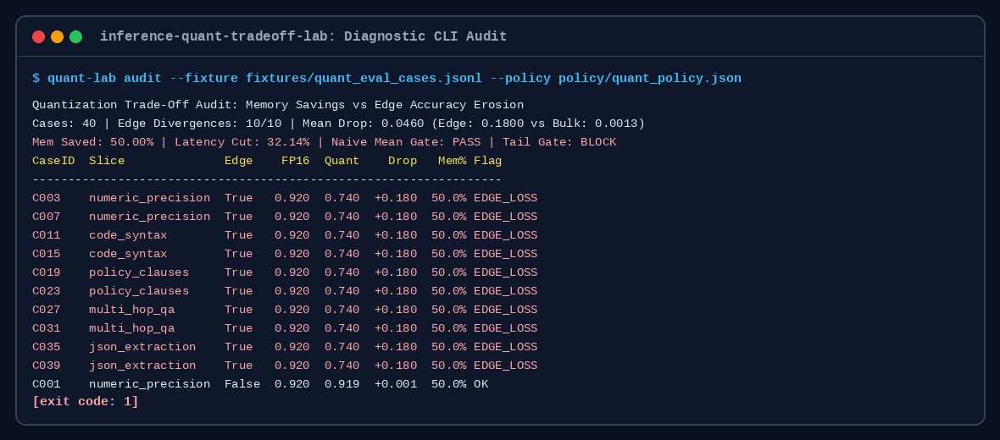
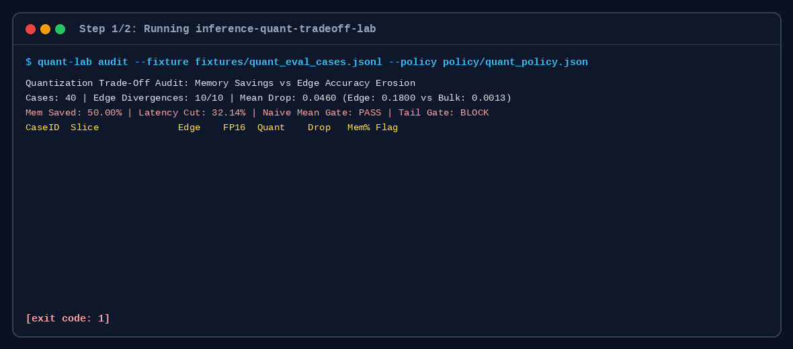

<div align="center">



[](https://github.com/htiwnah/inference-quant-tradeoff-lab/actions/workflows/ci.yml)
[](https://www.python.org/)
[](LICENSE)

**Deterministic offline quantization analyzer that forces every GPU memory reduction and latency speedup to price its exact edge-case accuracy cost.**

</div>

## The Structural Impossibility

Reporting lower GPU memory or faster token latency in isolation cannot tell you how much factual, numeric, or structural accuracy was traded away on hard edge-case inputs.

Four questions this tool answers that standard aggregate dashboards or point checks structurally cannot:

1. When INT4/QLoRA quantization cuts memory by 50% and latency by 32%, how much accuracy collapses on hard edge slices while aggregate averages stay green?
2. Why does a naive mean-accuracy gate (`max_mean_accuracy_drop = 0.05`) pass a candidate whose edge slice drops by `0.18`?
3. How sensitive is the divergence count to tightening or relaxing the edge-drop tolerance (`0.02` vs `0.05` vs `0.10` vs `0.20`)?
4. What is the coarsest failure rate (`1 / N`) observable on a 40-case paired compression suite?

## The Uncomfortable Numbers

* **Mean accuracy looks safe while 100% of edge cases fail:** Across `40 benchmark cases` (`10 edge cases`), the global `0.046 mean drop` passes a naive `<= 0.05` gate, yet **`10 edge divergences`** suffer a severe **`0.18 edge drop`**.
* **Headline hardware wins mask localized quality collapse:** `50.0% memory saved` (`4096 MB -> 2048 MB`) and `32.14% latency reduction` (`140 ms -> 95 ms`) hide `0.180` accuracy erosion on numeric precision, code syntax, policy clauses, multi-hop QA, and JSON extraction edge cases.
* **Corpus resolution bound:** With `40` paired prompts, one flipped case shifts rates by a **`2.5% resolution floor`** (`1 / 40`).

Credibility receipt: **`14 tests`** passing with **`99.27% line coverage`**, zero external runtime dependencies, and every published figure re-measured and phrase-verified across Python 3.10, 3.11, and 3.12 in CI.

## Quickstart

Prerequisites: Python 3.10+ (zero API keys, zero cloud credentials, zero network calls required).

```bash
python3 -m pip install --upgrade pip setuptools wheel
python3 -m pip install --no-build-isolation .
quant-lab audit --fixture fixtures/quant_eval_cases.jsonl --policy policy/quant_policy.json
make verify
```

Containerized one-command reproduction:

```bash
docker build -t inference-quant-tradeoff-lab .
docker run --rm inference-quant-tradeoff-lab audit --fixture fixtures/quant_eval_cases.jsonl --policy policy/quant_policy.json
```

## Claim 1: Bulk Easy Prompts Hide Severe Tail Erosion Under Mean Accuracy Gates

| Slice Cohort | Cases | Mean FP16 | Mean Quantized | Accuracy Drop | Gate Verdict |
| :--- | ---: | ---: | ---: | ---: | :--- |
| Bulk non-edge cases | `30` | `0.9200` | `0.9188` | `0.0013` | Looks clean |
| Hard `10 edge cases` | `10` | `0.9200` | `0.7400` | **`0.18 edge drop`** | **BLOCKED (`10 edge divergences`)** |
| **Combined corpus** | **`40 benchmark cases`** | `0.9200` | `0.8741` | **`0.046 mean drop`** | Naive mean gate (`<=0.05`) wrongly PASSES |

## Claim 2: Hardware Speedups Must Be Priced Side-by-Side With Tail Divergence

| Metric | FP16 Baseline | Quantized Candidate | Delta |
| :--- | ---: | ---: | :--- |
| GPU Memory Footprint | `4,096 MB` | `2,048 MB` | `50.0% memory saved` |
| Inference Latency | `140.0 ms` | `95.0 ms` | `32.14% latency reduction` |
| Edge-Case Divergences | `0` | `10 edge divergences` | Blocked by tail gate |

## Claim 3: Threshold Sensitivity Shows Sharp Cliff Between Bulk Noise and Edge Collapse

Sweeping `edge_drop_threshold` across `0.02`, `0.05`, `0.10`, and `0.20` (`docs/experiments/exp2_drop_sweep.json`) shows `10` edge divergences remain flagged all the way up to `0.10`, separating real quantization collapse (`0.18`) from normal bulk rounding jitter (`0.0013`).

## Bugs the Measurement Found (War Stories)

1. **Null `quant_score` crashing benchmark ingestion (`tests/test_quant_properties.py`):** When a quantized runner timed out and emitted `"quant_score": null`, casting `float(None)` raised `TypeError` and aborted the audit. Coercing `None` to `0.0` preserved batch auditing and immediately flagged the timed-out edge case (pinned in `test_war_story_null_quant_score_coerced_to_zero_without_crashing`).
2. **Python 3.12 CI build isolation lacking `setuptools` (`ADR-003`):** Explicitly installing `pip setuptools wheel` prior to `--no-build-isolation .` fixed Python 3.12 matrix runs across GitHub Actions and Docker.

## Architecture Diagram




## Evidence

Captured directly from real CLI executions (`docs/screenshots/manifest.json` and `docs/video/manifest.json` record every command and exit code):



Terminal replay of captured stdout across the CLI audit, experiments, and receipt verification (`docs/video/manifest.json`):



## The Awkward Corpus

* **5 enterprise inference slices (8 cases each):** `numeric_precision`, `code_syntax`, `policy_clauses`, `multi_hop_qa`, and `json_extraction`.
* **30 bulk cases:** Quantized score stays within `0.0013` of FP16 (`0.92 -> 0.91875`).
* **10 edge cases (2 per slice):** Quantized score collapses from `0.92` to `0.74` (`0.18` drop) while overall mean drop remains `0.046` (sneaking under a `0.05` mean gate).

## What This Cannot Measure

* **Live GPU kernel wall-clock timing:** Offline mode audits recorded benchmark JSONL rows and does not invoke CUDA, TensorRT-LLM, or vLLM directly (`ADR-005`).
* **Task-specific business cost weights:** Whether a `0.18` drop on `numeric_precision` outweighs a `50%` VRAM reduction depends on deployment SLA.
* **Error rates finer than `2.5%`:** A 40-case benchmark has a `1 / 40` resolution floor.

## Layout, Exit Codes, and Reproduction

```text
inference-quant-tradeoff-lab/
├── src/inference_quant_tradeoff_lab/  # config, analyzer, cli
├── policy/quant_policy.json  # edge divergence & mean drop budgets
├── fixtures/quant_eval_cases.jsonl  # 40 paired FP16 vs Quant cases
├── sql/quant_tradeoff.sql  # warehouse schema & edge-loss query
├── scripts/  # run_quant_audit.sh & verify_all.sh
├── experiments/run_experiments.py  # trade-off & threshold sweep experiments
├── tools/  # collect_metrics.py, check_numbers.py, check_repo_hygiene.py
├── tests/  # 14 property & CLI tests
└── docs/  # banner.svg, architecture.svg, demo.gif, index.html, ADRs
```

### CLI Exit Codes

* `0`: Trade-off audit passed both mean accuracy drop and edge divergence budgets.
* `1`: Audit answered cleanly ("no"): edge divergences or mean accuracy drop exceeded policy.
* `2`: Tool failed to answer due to missing file, non-positive memory values, or invalid flags.

### Make Targets

* `make hygiene`: Enforces zero em/en dashes, zero AI attribution in git history, valid workflow YAML, exact badge naming, and 120-char Python line length.
* `make test`: Runs all `14 tests`.
* `make experiments`: Re-runs deterministic experiments into `docs/experiments/`.
* `make receipts`: Re-runs experiments and tests, updates `docs/metrics.json`, and runs `tools/check_numbers.py` (which matches anchor phrases rather than bare numbers so stale prose fails CI).
* `make verify`: Executes `hygiene`, `lint`, `test`, and `receipts` end-to-end offline.

## Tech Stack and ADRs

| Component | Role | Why Chosen Here |
| :--- | :--- | :--- |
| Python 3.10+ stdlib | Paired parser, tail-slice analyzer, CLI | Zero runtime dependencies for air-gapped CI (`ADR-003`) |
| SQL (`sql/quant_tradeoff.sql`) | Benchmark storage and slice aggregation | Maps directly to experiment tracking warehouses |
| Multi-stage `Dockerfile` + `Makefile` | Portable offline verification | One-command deterministic reproduction |
| GitHub Actions (3.10/3.11/3.12) | Lint, tests, >=95% coverage floor, receipts | Re-verifies every figure automatically |

* [ADR 001 separate tail erosion from mean](docs/adr/ADR-001-separate-tail-erosion-from-mean.md)
* [ADR 002 explicit three way exit codes](docs/adr/ADR-002-explicit-three-way-exit-codes.md)
* [ADR 003 stdlib core and py312 ci](docs/adr/ADR-003-stdlib-core-and-py312-ci.md)
* [ADR 004 positive memory boundary](docs/adr/ADR-004-positive-memory-boundary.md)
* [ADR 005 offline hardware boundaries](docs/adr/ADR-005-offline-hardware-boundaries.md)

## The Pivot and Future Work

Live TensorRT-LLM / vLLM benchmark harnesses and automated AWQ/GPTQ quantization calibration runs are deliberately out of scope. **Trigger condition to build them:** once GPU runner pools exist in CI and teams want live engine-build artifacts fed straight into `quant-lab`.

Future v2 milestones:

* Add an optional Triton / vLLM `perf_analyzer` CSV importer translating live throughput logs into `QuantCase` JSONL.
* Support per-slice custom drop ceilings (stricter on `numeric_precision` and `json_extraction` than open-ended chat).
* Track **edge divergence count per quantization bit-width** as the primary release health metric.
